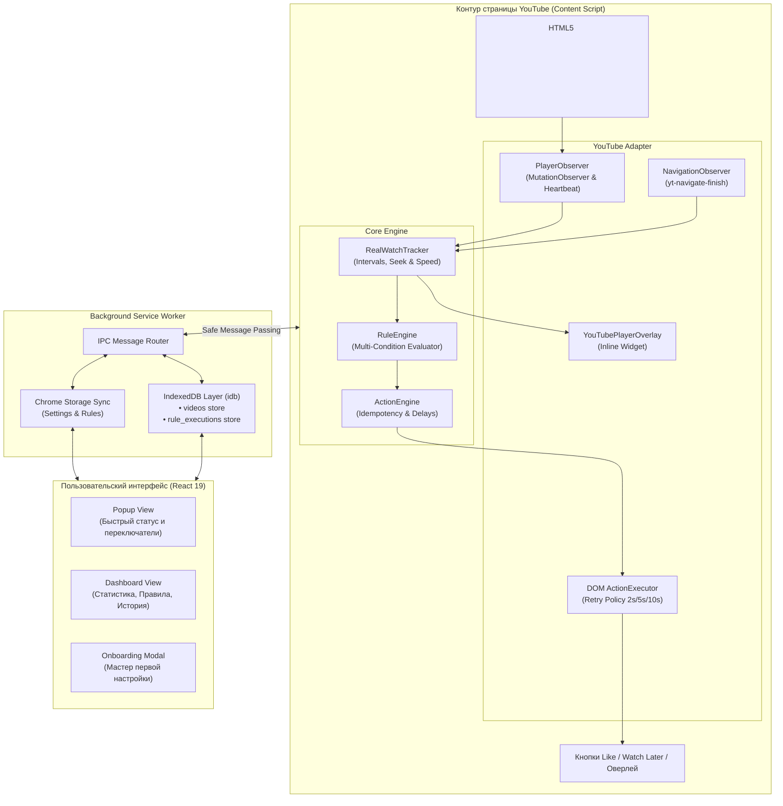

<div align="center">

  

  # YouTube Autopilot

  **Интеллектуальное расширение для автоматизации рутинных действий на YouTube с учетом честного времени просмотра и перемоток.**

  [](package.json)
  [](https://wxt.dev)
  [](https://react.dev)
  [](https://www.typescriptlang.org/)
  [](https://tailwindcss.com)
  [](https://developer.chrome.com/docs/extensions/mv3/intro/)
  [](https://developer.mozilla.org/en-US/docs/Mozilla/Add-ons/WebExtensions)
  [](LICENSE)

  <p align="center">
    <a href="#-ключевые-возможности">Возможности</a> •
    <a href="#-режимы-отслеживания-просмотра">Режимы просмотра</a> •
    <a href="#-архитектура">Архитектура</a> •
    <a href="#-быстрый-старт">Установка и запуск</a> •
    <a href="#-структура-проекта">Структура</a> •
    <a href="#-безопасность-и-приватность">Приватность</a>
  </p>
</div>

---

## 📖 О проекте

**YouTube Autopilot** — современное расширение для браузеров Chrome и Firefox, созданное для того, чтобы освободить зрителя от рутины: ручной расстановки лайков досмотренным роликам, очистки переполненного плейлиста «Смотреть позже» и сохранения любимого контента.

В отличие от примитивных скриптов, ориентирующихся на случайный клик или факт открытия страницы, YouTube Autopilot анализирует **реальное воспроизведение** видео: интервалы непрерывного просмотра, скорость плеера (1x–2x), активность фоновых вкладок и поведение пользователя при перемотке на таймлайне.

---

## ✨ Ключевые возможности

| Возможность | Описание |
| :--- | :--- |
| ⏱️ **Умный трекинг времени** | Алгоритм объединения непересекающихся интервалов (`RealWatchTracker`). Понимает разницу между честным просмотром и беглой перемоткой. |
| ⚡ **Режим перемотки (Seek to 90%)** | Позволяет поставить лайк, если видео смотрелось фрагментами (начало → середина → конец) и ползунок пересек порог 90%. |
| 🎯 **Гибкий движок правил (Rule Engine)** | Конструктор автоматизаций с логикой **ЕСЛИ → КОГДА → ТОГДА**. Поддерживает пороги %, длительность, каналы, Shorts и статус подписки. |
| 🛡️ **Режимы подтверждения** | **Approval Mode**: интерактивное всплывающее уведомление на YouTube с кнопками «Разрешить» / «Пропустить».<br>**Automatic Mode**: тихое фоновое выполнение. |
| 📌 **Инлайн-оверлей в плеере YouTube** | Нативный капсульный виджет рядом с элементами управления плеера: показывает % просмотра, точное время и бейдж следующего действия (Pixel Perfect, WCAG). |
| 📊 **Аналитический Dashboard** | Полноценная панель управления: суммарная статистика, история просмотров по видео, управление плейлистом «Смотреть позже» и пресеты правил. |
| 🌍 **Мультиязычность (i18n)** | 100% локализация интерфейса на русском и английском языках (`ru`, `en`, `auto`) без жестко зашитых строк. |
| 🔒 **100% Локальные данные** | Вся история, правила и статистика хранятся исключительно на вашем устройстве в локальной IndexedDB. Никакой телеметрии и серверов. |

---

## 🎛️ Режимы отслеживания просмотра

В настройках расширения доступны три интеллектуальных режима учета хронометража:

```
┌─────────────────────────────────────────────────────────────────────────────┐
│ 1. Честное время (Real Watch Mode)                                         │
│    • Суммируются только фактически просмотренные секунды.                   │
│    • Перемотка вперед/назад не добавляет фиктивного времени.                │
│    • Идеально для: строгой поддержки авторов только за полный просмотр.     │
├─────────────────────────────────────────────────────────────────────────────┤
│ 2. С учетом перемотки (Position / Scrubber Mode)                           │
│    • Отслеживается максимальная отметка ползунка плеера (maxPosition).      │
│    • Посмотрели начало (0–5с), перемотали в середину (50с) и в конец (90с+) │
│      → засчитывается 90%+ и мгновенно ставится автолайк!                    │
│    • Идеально для: удобного просмотра длинных подкастов, лекций и обзоров.  │
├─────────────────────────────────────────────────────────────────────────────┤
│ 3. Гибридный режим (Hybrid Mode) — Рекомендуется                           │
│    • Автолайк срабатывает при пересечении 90% ползунком И просмотре хотя бы │
│      15% длительности видео (или 30 секунд).                                │
│    • Надежная защита от случайных кликов в конец при открытии ролика.       │
└─────────────────────────────────────────────────────────────────────────────┘
```

---

## 🏗️ Архитектура

Проект построен по модульному принципу **Separation of Concerns** с четкими границами ответственности:



---

## 🛠️ Стек технологий

- **Фреймворк:** [WXT 0.19+](https://wxt.dev) — фреймворк нового поколения для браузерных расширений с поддержкой Vite и HMR.
- **UI-библиотека:** [React 19](https://react.dev) + [Tailwind CSS 3.4](https://tailwindcss.com).
- **Язык:** [TypeScript 5.7+](https://www.typescriptlang.org/) (Strict mode, нулевые `any`).
- **База данных:** [IndexedDB](https://developer.mozilla.org/en-US/docs/Web/API/IndexedDB_API) с оберткой [`idb`](https://github.com/jakearchibald/idb).
- **Иконки:** [Lucide React](https://lucide.dev) (чистый SVG, без тяжелых растровых изображений).
- **Сборка:** [Vite 6](https://vitejs.dev) для мгновенной компиляции и сборки под Chrome (MV3) и Firefox (MV2).

---

## 🚀 Быстрый старт

### Требования
- **Node.js**: `v18.0.0` или выше
- **Менеджер пакетов**: `npm` (или `pnpm` / `yarn`)

### 1. Клонирование и установка зависимостей
```bash
git clone https://github.com/denis-ershov/YouTube-Autopilot.git
cd "YouTube-Autopilot"
npm install
```

### 2. Запуск в режиме разработки (с Live Reload)
Для Google Chrome:
```bash
npm run dev
```
Для Mozilla Firefox:
```bash
npm run dev:firefox
```
*WXT автоматически откроет тестовый профиль браузера с установленным расширением.*

### 3. Сборка для публикации (Production)
```bash
# Сборка сразу для Chrome (MV3) и Firefox (MV2)
npm run build:all

# Или раздельно:
npm run build:chrome
npm run build:firefox

# Создание готовых .zip архивов для Web Store / AMO:
npm run zip:all
```
Собранные файлы расширения располагаются в директории `.output/`:
- `.output/chrome-mv3/` — готовая папка для Chrome, Brave, Edge, Opera, Яндекс.Браузера.
- `.output/firefox-mv2/` — готовая папка для Mozilla Firefox.

### 4. Ручная установка в браузер

#### В Google Chrome / Edge / Brave:
1. Откройте страницу `chrome://extensions/` (или `edge://extensions/`).
2. Включите переключатель **«Режим разработчика»** (Developer mode) в правом верхнем углу.
3. Нажмите кнопку **«Загрузить распакованное расширение»** (Load unpacked).
4. Выберите папку `.output/chrome-mv3`.

#### В Mozilla Firefox:
1. Откройте страницу `about:debugging#/runtime/this-firefox`.
2. Нажмите **«Загрузить временное дополнение...»** (Load Temporary Add-on).
3. Выберите файл `.output/firefox-mv2/manifest.json`.

---

## 📁 Структура проекта

```text
├── entrypoints/                 # Точки входа расширения (WXT convention)
│   ├── background.ts            # Background Service Worker (IPC, IndexedDB)
│   ├── content.ts               # Content Script на youtube.com
│   ├── dashboard/               # Полноэкранный React Dashboard
│   │   ├── App.tsx
│   │   ├── index.html
│   │   └── main.tsx
│   └── popup/                   # Компактный React Popup
│       ├── App.tsx
│       ├── index.html
│       └── main.tsx
├── src/
│   ├── components/              # Переиспользуемые UI-компоненты (Onboarding, Logo)
│   ├── core/                    # Бизнес-логика, не зависящая от DOM
│   │   ├── actions/             # ActionEngine (идемпотентность, кулдауны)
│   │   ├── rules/               # RuleEngine (оценка условий)
│   │   ├── storage/             # Хранилище настроек chrome.storage
│   │   ├── utils/               # Утилиты рантайма и безопасный safeSendMessage
│   │   └── watcher/             # RealWatchTracker (интервалы, перемотка)
│   ├── database/                # Слой хранения IndexedDB (клиент idb)
│   ├── i18n/                    # Модуль интернационализации
│   ├── locales/                 # Словари локализации (ru.json, en.json)
│   ├── types/                   # TypeScript интерфейсы и контракты
│   └── youtube/                 # Изолированный слой работы с YouTube
│       ├── actions.ts           # Нажатие кнопок Like / Watch Later
│       ├── adapter.ts           # Фасад взаимодействия
│       ├── navigation.ts        # Отслеживание SPA-переходов
│       ├── overlay.ts           # Инлайн-виджет плеера
│       ├── player.ts            # PlayerObserver
│       └── selectors.ts         # CSS-селекторы плеера
├── docs/                        # Архитектурная документация и CHANGELOG
│   ├── PARSING_ARCHITECTURE.md  # Детальное описание алгоритмов трекинга и DOM
│   └── CHANGELOG.md             # Журнал всех версий и изменений
├── public/                      # Статические ресурсы и иконки
├── package.json
├── tsconfig.json
└── wxt.config.ts                # Конфигурация сборщика WXT
```

---

## 🔒 Безопасность и приватность

- **Никаких внешних запросов:** расширение не отправляет ваши данные, историю просмотров или cookie на сторонние серверы.
- **Минимальные разрешения (`permissions`):** запрашиваются только `storage` и доступ к хостам `*://*.youtube.com/*`.
- **Изоляция контекста:** скрипты контента работают в изолированном мире расширения и используют безопасный транспорт сообщений с проверкой валидности рантайма.
- **Идемпотентность действий:** каждое действие проверяется по базе выполненных автоматизаций, исключая повторные или ошибочные лайки.

---

## 📄 Лицензия

Проект распространяется под свободной лицензией **MIT**. Подробности в файле [LICENSE](LICENSE).

<div align="center">
  <sub>Создано с ❤️ для комфортного просмотра YouTube.</sub>
</div>
