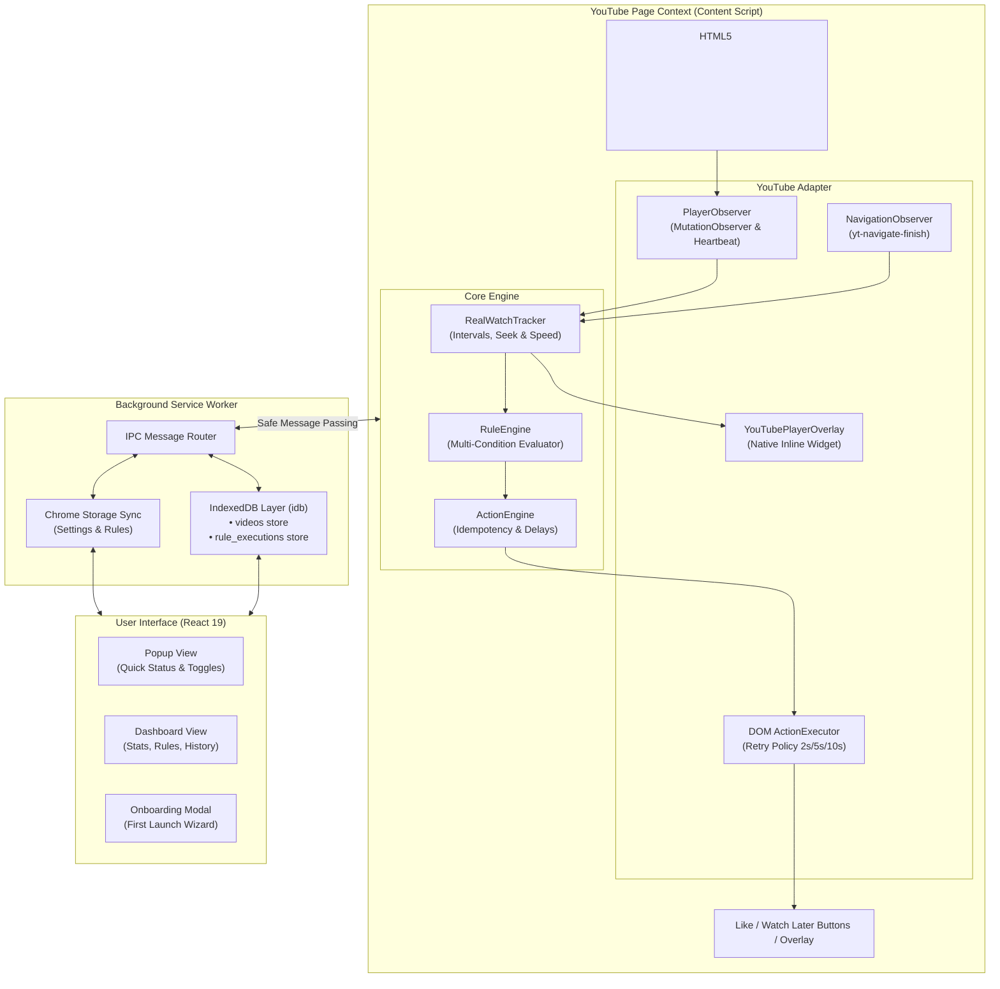

<div align="center">

  

  # YouTube Autopilot

  **Intelligent browser extension for automating routine YouTube actions based on genuine watch time and fast-forward seek behavior.**

  [](package.json)
  [](https://wxt.dev)
  [](https://react.dev)
  [](https://www.typescriptlang.org/)
  [](https://tailwindcss.com)
  [](https://developer.chrome.com/docs/extensions/mv3/intro/)
  [](https://addons.mozilla.org/)
  [](LICENSE)

  <p align="center">
    <b>English</b> • <a href="README.md">Русский</a>
  </p>

  <p align="center">
    <a href="#-key-features">Features</a> •
    <a href="#-watch-tracking-modes">Watch Modes</a> •
    <a href="#-architecture">Architecture</a> •
    <a href="#-quick-start">Quick Start</a> •
    <a href="BUILD.md">Build Instructions</a> •
    <a href="CONTRIBUTING.md">Contributing</a> •
    <a href="#-security-and-privacy">Privacy</a>
  </p>
</div>

---

## 📖 About The Project

**YouTube Autopilot** is a modern browser extension for Chrome and Firefox built to eliminate repetitive YouTube tasks: manually liking videos you finished, clearing bloated "Watch Later" playlists, and organizing your favorite content.

Unlike simplistic scripts that trigger on a single click or page load event, YouTube Autopilot analyzes **genuine playback**: tracking continuous viewing intervals, playback speed (1x–2x), tab visibility states, and user seeking patterns along the video timeline.

---

## ✨ Key Features

| Feature | Description |
| :--- | :--- |
| ⏱️ **Smart Time Tracking** | Non-overlapping interval merging algorithm (`RealWatchTracker`). Understands the difference between attentive watching and skimming. |
| ⚡ **Fast-Forward & Seek (90%)** | Automatically likes videos when watched in chunks (intro → highlights → ending) and the playhead reaches 90%. |
| 🎯 **Flexible Rule Engine** | No-code automation constructor using **IF → WHEN → THEN** logic. Supports % thresholds, duration, channel filters, Shorts, and subscription checks. |
| 🛡️ **Operation Modes** | **Approval Mode**: Non-intrusive interactive prompt ("Allow" / "Skip") on the video.<br>**Automatic Mode**: Silent, seamless background execution. |
| 📌 **Native Player Overlay** | Sleek pill widget embedded inside YouTube's control bar: displays watch %, elapsed time, and scheduled action badge (Pixel Perfect, WCAG). |
| 📊 **Analytics Dashboard** | Full-screen control panel: aggregate stats, detailed watch history, Watch Later cleaner, and rule presets. |
| 🌍 **Bilingual (i18n)** | 100% interface localization in English and Russian (`ru`, `en`, `auto`) with zero hardcoded strings. |
| 🔒 **100% Local Storage** | All history, rules, and statistics reside exclusively on your machine in IndexedDB. Zero telemetry, no external servers. |

---

## 🎛️ Watch Tracking Modes

Three configurable tracking modes are available in the extension settings:

```
┌─────────────────────────────────────────────────────────────────────────────┐
│ 1. Real Watch Time (Strict Mode)                                            │
│    • Counts only genuinely watched playback seconds.                         │
│    • Fast-forwarding and seeking do not add fake watch time.                 │
│    • Ideal for: supporting creators strictly after complete viewing.         │
├─────────────────────────────────────────────────────────────────────────────┤
│ 2. Timeline Position (Scrubber Mode)                                        │
│    • Tracks the maximum position reached by the player scrubber.            │
│    • Watch intro (0–5s), skip to middle (50s) and then end (90s+)           │
│      → counts as 90%+ and instantly triggers Auto-Like!                     │
│    • Ideal for: podcasts, tutorials, lecture recordings, and long streams.  │
├─────────────────────────────────────────────────────────────────────────────┤
│ 3. Hybrid Mode — Recommended                                                │
│    • Auto-like triggers when the playhead reaches 90% AND you have           │
│      genuinely watched at least 15% (or 30 seconds) of the video.            │
│    • Eliminates accidental triggers when inadvertently clicking near the end.│
└─────────────────────────────────────────────────────────────────────────────┘
```

---

## 🏗️ Architecture

The project follows a modular **Separation of Concerns** architecture with explicit component boundaries:



---

## 🛠️ Technology Stack

- **Framework:** [WXT 0.19+](https://wxt.dev) — Next-gen extension framework powered by Vite and HMR.
- **UI Library:** [React 19](https://react.dev) + [Tailwind CSS 3.4](https://tailwindcss.com).
- **Language:** [TypeScript 5.7+](https://www.typescriptlang.org/) (Strict mode, zero `any`).
- **Database:** [IndexedDB](https://developer.mozilla.org/en-US/docs/Web/API/IndexedDB_API) with [`idb`](https://github.com/jakearchibald/idb).
- **Icons:** [Lucide React](https://lucide.dev) (Clean SVG, no raster assets).
- **Bundler:** [Vite 6](https://vitejs.dev) for fast builds targeting Chrome (MV3) and Firefox (MV2).

---

## 🚀 Quick Start

### Prerequisites
- **Node.js**: `v18.0.0` or higher
- **Package Manager**: `npm` (or `pnpm` / `yarn`)

### 1. Clone & Install Dependencies
```bash
git clone https://github.com/denis-ershov/YouTube-Autopilot.git
cd YouTube-Autopilot
npm install
```

### 2. Development Server (with Live Reload)
For Google Chrome:
```bash
npm run dev
```
For Mozilla Firefox:
```bash
npm run dev:firefox
```
*WXT will automatically launch a dedicated browser test profile with the extension loaded.*

### 3. Production Build & Packaging
```bash
# Build both Chrome (MV3) and Firefox (MV2):
npm run build:all

# Or build individually:
npm run build:chrome
npm run build:firefox

# Create deployable .zip archives for Web Store & AMO:
npm run zip:all
```
Compiled extension bundles are placed in the `.output/` directory:
- `.output/chrome-mv3/` — Unpacked directory for Chrome, Brave, Edge, Opera, Vivaldi.
- `.output/firefox-mv2/` — Unpacked directory for Mozilla Firefox.

### 4. Manual Browser Installation

#### In Google Chrome / Edge / Brave:
1. Open `chrome://extensions/` (or `edge://extensions/`).
2. Enable **"Developer mode"** in the top-right corner.
3. Click **"Load unpacked"**.
4. Select the `.output/chrome-mv3` folder.

#### In Mozilla Firefox:
1. Open `about:debugging#/runtime/this-firefox`.
2. Click **"Load Temporary Add-on..."**.
3. Select the `.output/firefox-mv2/manifest.json` file.

---

## 📁 Project Structure

```text
├── entrypoints/                 # Extension entry points (WXT convention)
│   ├── background.ts            # Background Service Worker (IPC, IndexedDB)
│   ├── content.ts               # Content Script on youtube.com
│   ├── dashboard/               # Full-screen React Dashboard
│   │   ├── App.tsx
│   │   ├── index.html
│   │   └── main.tsx
│   └── popup/                   # Compact React Popup
│       ├── App.tsx
│       ├── index.html
│       └── main.tsx
├── src/
│   ├── components/              # Reusable UI components (Onboarding, Logo)
│   ├── core/                    # Core business logic (DOM-independent)
│   │   ├── actions/             # ActionEngine (idempotency, cooldowns)
│   │   ├── rules/               # RuleEngine (condition evaluators)
│   │   ├── storage/             # chrome.storage persistence
│   │   ├── utils/               # Safe messaging utilities
│   │   └── watcher/             # RealWatchTracker (intervals, seek)
│   ├── database/                # IndexedDB persistence (idb wrapper)
│   ├── i18n/                    # Localization system
│   ├── locales/                 # Translation dictionaries (ru.json, en.json)
│   ├── types/                   # TypeScript interfaces and contracts
│   └── youtube/                 # YouTube DOM isolation layer
│       ├── actions.ts           # DOM button clicks (Like, Watch Later)
│       ├── adapter.ts           # Facade orchestrator
│       ├── navigation.ts        # SPA navigation observer
│       ├── overlay.ts           # Native player widget
│       ├── player.ts            # PlayerObserver
│       └── selectors.ts         # Player CSS selectors
├── docs/                        # Architecture specs and Changelog
│   ├── API_ARCHITECTURE.md      # IPC message bus and contracts
│   ├── DB_ARCHITECTURE.md       # IndexedDB and storage schemas
│   ├── PARSING_ARCHITECTURE.md  # Tracking algorithms and selectors
│   └── CHANGELOG.md             # Version history and releases
├── public/                      # Static assets and icons
├── .github/                     # GitHub Actions CI and Issue templates
├── BUILD.md                     # Reproducible build instructions (AMO)
├── CONTRIBUTING.md              # Contribution guidelines
├── SECURITY.md                  # Security and privacy policy
├── package.json
├── tsconfig.json
└── wxt.config.ts                # WXT bundler configuration
```

---

## 🔒 Security and Privacy

- **Mozilla AMO Compliance:**
  - **Data Collection Declaration (`data_collection_permissions`):** Formally declared `"required": ["none"]` with zero personal data collection.
  - **Safe DOM (No `innerHTML`):** Strictly uses native DOM methods (`document.createElement`, `document.createTextNode`, `textContent`), ensuring zero AMO security warnings and complete XSS protection.
- **Zero External Network Calls:** The extension does not transmit watch history, cookies, or identifiers to any remote server (100% Privacy-First).
- **Minimal Permissions:** Requests only `storage`, `activeTab`, and host permissions for `*://*.youtube.com/*`.
- **Context Isolation:** Content scripts run in an isolated extension world and communicate via safe IPC message passing.
- **Idempotency:** Every automated action is verified against an IndexedDB execution log to prevent duplicate likes or redundant clicks.

---

## 📄 License

This project is licensed under the **MIT License**. See the [LICENSE](LICENSE) file for details.

<div align="center">
  <sub>Built with ❤️ for a cleaner, smarter YouTube experience.</sub>
</div>
